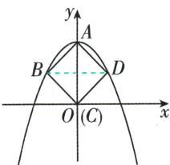
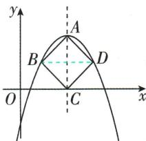

> [!success]- 必刷题
>
> > [!success] **【答案】** -1
>
> > [!note]- **【解析】**
> > 【解】(1) $\because y=ax^{2}+2,\therefore$ 顶点A(0,2)，对称轴为y轴，∴点C的坐标为(0,0)，∴AC=2。如图(1)，连接BD。∵四边形ABCD为正方形，∴BD⊥OA且平分OA,BD=OA=2，∴点D的坐标为(1,1)。∵点D在抛物线 $y=ax^{2}+2$ 上，∴将点D的坐标代入 $y=ax^{2}+2$ 得 $1=a\times1^{2}+2$ ，解得a=-1。故答案为-1。
> >
> > 
> > 图(1)
> >
> > 
> > 图(2)
> >
> > (2) $\because y=-\frac{1}{2}(x-1)^{2}+k,\therefore$ 顶点A的坐标为(1,k)，点C的坐标为(1,0).如图(2)，连接BD.同(1)可得点D的坐标为 $\left(\frac{1}{2}k+1,\frac{1}{2}k\right)$ .
> > ∵点D在抛物线 $y=-\frac{1}{2}(x-1)^{2}+k$ 上，∴将点D的坐标代入 $y=-\frac{1}{2}(x-1)^{2}+k$ 得 $\frac{k}{2}=-\frac{1}{2}\left(\frac{k}{2}+1-1\right)^{2}+k$ ，解得 $k_{1}=0$ （舍去）， $k_{2}=4$ 。故答案为4.
> > (3) $\because y=a(x-h)^{2}+k,\therefore$ 顶点A的坐标为(h,k)，点C的坐标为(h,0).同理可得，点D的坐标为 $\left(\frac{1}{2}k+h,\frac{1}{2}k\right)$ ，将点D的坐标代入 $y=a(x-h)^{2}+k$ 得 $\frac{k}{2}=a\left(\frac{k}{2}+h-h\right)^{2}+k$ ，化简得ak=-2。故a,k之间的数量关系为ak=-2。
> >
> > 点 D 的横坐标等于 OC + $\frac{1}{2}AC$ ，纵坐标等于 $\frac{1}{2}AC$ .
> >
> > 顶点在 x 轴上,说明顶点纵坐标为 0,顶点坐标公式为 $\left(-\frac{b}{2a},\frac{4ac-b^{2}}{4a}\right)$ .
> >
> > 22.1.4 二次函数 $y = ax^{2} + bx + c$ 的图象和性质
> >
> > ## 一题多解
> >
> > 课时1 二次函数 $y = ax^{2} + bx + c$ 的图象和性质
> >
> > 除了可以用配方法化一般式为顶点式外，也可用顶点的坐标公式
