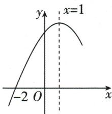

<!-- question-source:start -->
6[中]抛物线 $y = ax^{2} + bx + c$ 经过点(-2,0)，且对称轴为直线 $x = 1$ ，其部分图象如图所示。对于此抛物线有如下四个结论：
① $b = -2a$ ;
② $4a + 2b + c > 0$ ;
③若 $n > m > 0$ ，则 $x = 1 + m$ 时的函数值小于 $x = 1 - n$ 时的函数值；
④点 $\left(-\frac{c}{2a},0\right)$ 一定在此抛物线上。
其中正确的结论是\_\_\_\_。（填序号）

<!-- question-source:end -->

![[Q00107181A1]]
