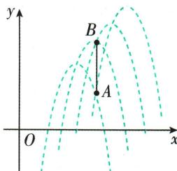

> [!success]- 必刷题
>
> > [!success] **【答案】** D
>
> > [!note]- **【解析】**
> > 把 $A(4,2)$ 代入 $y = -(x - t)^{2} + t$ $(t \geqslant 0)$ 得 $2 = -(4 - t)^{2} + t$ ，解得 t = 3 或 t = 6。把 $B(4,4)$ 代入 $y = -(x - t)^{2} + t$ （ $t \geqslant 0$ ）得 4 =
> >
> > 
> >
> > $-(4-t)^{2}+t$ , 解得 t=4 或 t=5. 结合图象可知，当 L 与线段 AB 有公共点时，t 的取值范围是 $3 \leqslant t \leqslant 4$ 或 $5 \leqslant t \leqslant 6$ ，
> >
> > 故选 **D**.
