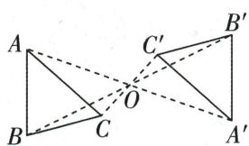
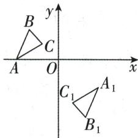

<!-- question-source:start -->
1 如图, $\triangle ABC$ 与 $\triangle A'B'C'$ 关于点 $O$ 成中心对称, 则下列结论不一定成立的是 ( )
A. 点 $A$ 与点 $A'$ 是对称点
B. $BO = B'O$ C. $\angle AOB = \angle A'OB'$ D. $\angle ACB = \angle C'A'B'$

(第1题图)

(第2题图)
<!-- question-source:end -->

![[Q00106773A1]]
