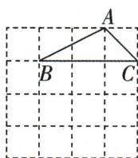
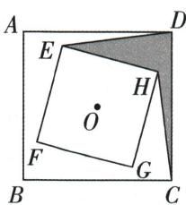

<!-- question-source:start -->
3[2025 江苏泰州期中]如图,在 $4 \times 4$ 的方格纸中,画 $\triangle A_{1}B_{1}C_{1}$ (顶点均在格点上)与 $\triangle ABC$ (顶点均在格点上)关于方格纸中的一个格点成中心对称,这样的 $\triangle A_{1}B_{1}C_{1}$ 有 \_\_\_\_ 个.

(第3题图)

(第 4 题图)
<!-- question-source:end -->

![[Q00106775A1]]
