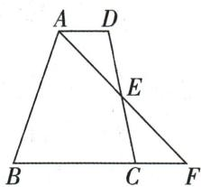

<!-- question-source:start -->
5 如图, 在四边形 ABCD 中, $AD \parallel BC$ , E 是 CD 上一点, 点 D 与点 C 关于点 E 成中心对称, 连接 AE 并延长, 与 BC 延长线交于点 F.

(1) 填空: E 是线段 CD 的\_\_\_\_, 点 A 与点 F 关于点\_\_\_\_成中心对称, 若 AB = AD + BC, 则 $\triangle ABF$ 是\_\_\_\_三角形.

(2) 四边形 ABCD 的面积为 12, 求 $\triangle ABF$ 的面积.

<!-- question-source:end -->

![[Q00106777A1]]
