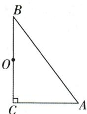

<!-- question-source:start -->
6[2024 湖南长沙质检]如图所示,在 $\triangle ABC$ 中, $\angle ACB=90^{\circ}$ ,点 $O$ 是 $BC$ 的中点.

(1) 求作以点 O 为对称中心, 与 $\triangle ABC$ 成中心对称的 $\triangle A'B'C'$ ;

(2) 若 $AB = 8, AC = 6$ , 求 $AA'$ 的长度.

<!-- question-source:end -->

![[Q00106778A1]]
