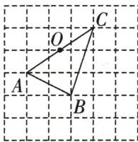
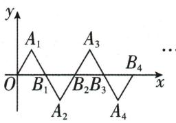

<!-- question-source:start -->
1[2024 河北沧州期中, 中]如图, 在边长为 1 的小正方形组成的网格中, 每个小正方形的顶点称为格点, $\triangle ABC$ 的三个顶点 $A, B, C$ 均在格点上, $O$ 是 $AC$ 与网格线的交点, 将 $\triangle ABC$ 绕着点 $O$ 顺时针旋转 $180^{\circ}$ . 以下是嘉嘉和淇淇得出的结论, 下列判断正确的是 ( )嘉嘉: 旋转后的三角形的三个顶点均在格点上; 淇淇: 旋转前后两个三角形可形成平行四边形. A. 只有嘉嘉对 B. 只有淇淇对 C. 两人都对 D. 两人都不对

(第1题图)

(第2题图)
<!-- question-source:end -->

![[Q00106779A1]]
