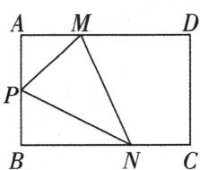
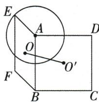

<!-- question-source:start -->
3[2024 江苏泰州期末, 中]如图, 在矩形 ABCD 中, AB=4, AD=6, 点 P, M, N 分别在边 AB, AD, BC 上运动, 且线段 MN 始终经过矩形的对称中心, 则 $\triangle PMN$ 周长的最小值为 \_\_\_\_.

(第3题图)

(第4题图)
<!-- question-source:end -->

![[Q00106781A1]]
