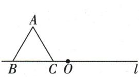
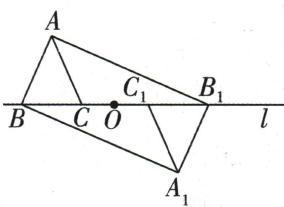
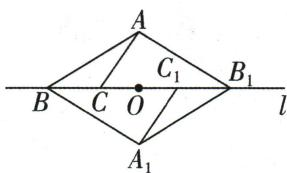
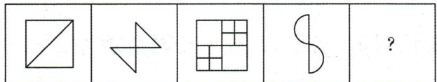

<!-- question-source:start -->
5 思想方法 分类讨论 [2025 江苏淮安期中, 较难] 如图(1), $\triangle ABC$ 是等边三角形, $BC$ 边在直线 $l$ 上, 动点 $O$ 在直线 $l$ 上 ( $O$ 不与点 $B$ 重合). 操作探究 1: 在图(1)中作出 $\triangle ABC$ 关于点 $O$ 的中心对称图形 $\triangle A_{1}B_{1}C_{1}$ , 连接 $AB_{1}, A_{1}B$ , 则四边形 $ABA_{1}B_{1}$ 的形状是 \_\_\_\_. 操作探究 2: 如图(2), 若把等边三角形改为等腰三角形 ( $\triangle ABC$ 中 $AB = AC$ ), 动点 $O$ 在直线 $l$ 上 ( $O$ 不与点 $B$ 重合), $\triangle ABC$ 与 $\triangle A_{1}B_{1}C_{1}$ 关于 $O$ 成中心对称, 当 $C_{1}$ 在 $C$ 的右侧且 $\angle C_{1}BA_{1} = \frac{1}{2}\angle BAC$ 时, 判断四边形 $ABA_{1}B_{1}$ 的形状, 并说明理由. 操作探究 3: 若 $\triangle ABC$ 是任意三角形, 且点 $A$ 在直线 $l$ 的上方, 动点 $O$ 在直线 $l$ 上 ( $O$ 不与点 $B$ 重合), 在图(3)中已作出 $\triangle ABC$ 关于点 $O$ 的中心对称图形 $\triangle A_{1}B_{1}C_{1}$ 的一个参考图形, 连接 $AB_{1}, A_{1}B$ , 当 $\angle ABC$ 与 $\angle C_{1}BA_{1}$ 满足什么关系时, 四边形 $ABA_{1}B_{1}$ 是正方形? 直接写出答案.

图(1)
图(2)

图(3)

电子错题本鸭
<!-- question-source:end -->

![[Q00106783A1]]
