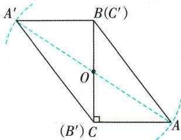

> [!success]- 必刷题
>
> > [!success] **【答案】** B
>
> > [!note]- **【解析】**
> > 【解】(1) 连接 AO 并延长, 以点 O 为圆心, OA 为半径画弧, 交 AO 的延长线于 $A'$ , 连接 $A'B$ , $A'C$ , 则 $\triangle A'B'C'$ 为所求
> >
> > 
> >
> > 作的三角形,如图所示.
> >
> > (2) $\because AB = 8, AC = 6, \angle ACB = 90^{\circ}, \therefore BC = \sqrt{AB^{2} - AC^{2}} = 2\sqrt{7}$ . $\because O$ 为 $BC$ 的中点, $\therefore OC = \frac{1}{2} BC = \sqrt{7}, \therefore AO = \sqrt{AC^{2} + CO^{2}} = \sqrt{43}, \therefore AA' = 2AO = 2\sqrt{43}$ .
