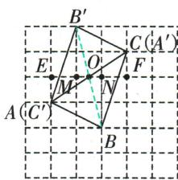

> [!success]- 必刷题
>
> > [!success] **【答案】** C
>
> > [!note]- **【解析】**
> > 如图,取格点 $B'$ , 连接 $OB'$ , OB, 取格点 E, F, M, N, 构成 $\triangle AOE$ 和 $\triangle COF$ , $\triangle B'OM$ 和 $\triangle BON$ . $\because \angle AEO = \angle CFO$ , $\angle AOE = \angle COF$ ,
> >
> > $AE = CF, \therefore \triangle AOE \cong \triangle COF, \therefore OA = OC, \therefore$ 点 $A$ 关于点 $O$ 的对称点 $A'$ 与点 $C$ 重合，点 $C$ 关于点 $O$ 的对称点 $C'$ 与点 $A$ 重合. 同理可证点 $B$ 与点
> >
> > 
> >
> > $B'$ 关于点 O 对称, ∴ 旋转后的三角形的三个顶点均在格点上, 故嘉嘉说法正确; 由中心对称的性质得 $\triangle ABC \cong \triangle A'B'C'$ , ∴ $AB = A'B'$ , $BC = B'C'$ , ∴ 四边形 $ABA'B'$ 是平行四边形, ∴ 旋转前后两个三角形可形成平行四边形, 故淇淇说法正确.
> >
> > 故选 **C**.
