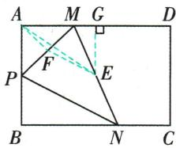

> [!success]- 必刷题
>
> > [!success] **【答案】** $2\sqrt{13} + 4$
>
> > [!note]- **【解析】**
> > 如图, 取 PM 的中点 F, MN 的中点 E, 过 E 作 $EG \perp AD$ 于 G, 连接 AE, AF,
> >
> > FE, 则 $EF = \frac{1}{2}PN, EN = \frac{1}{2}MN.$ ∵ 线段 MN 始终经过矩形的对称中心, ∴ E
> >
> > 
> >
> > 由 MN 始终经过矩形的对称中心, 取 MP 的中点 F, NM 的中点 E, 先求 $\triangle PMN$ 周长的一半的最值, 从而解决问题.
> >
> > 是定点, 则 $EM$ 的最小值为 $EG$ 的长. 当 $A, F$ , $E$ 三点共线时, $AF + EF$ 的值最小, 最小值为 $AE$ 的长, $\therefore AF + EF + EM \geqslant AE + EG$ . $\because$ 四边形 $ABCD$ 是矩形, $\therefore \angle PAM = 90^\circ$ , $EG = \frac{1}{2} AB = 2$ , $AG = \frac{1}{2} AD = 3$ , $\therefore AF = \frac{1}{2} PM$ , $\therefore PM = 2AF$ . $\because MN = 2EM$ , $PN = 2EF$ , $\therefore C_{\triangle PMN} = PM + PN + MN = 2AF + 2EF + 2EM = 2(AF + EF + EM) \geqslant 2(AE + EG)$ . $\because AE = \sqrt{AG^2 + EG^2} = \sqrt{3^2 + 2^2} = \sqrt{13}$ , $\therefore C_{\triangle PMN} \geqslant 2(\sqrt{13} + 2)$ , $\therefore C_{\triangle PMN}$ 的最小值为 $2\sqrt{13} + 4$ . 故答案为 $2\sqrt{13} + 4$ .
