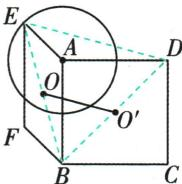

> [!success]- 必刷题
>
> > [!success] **【答案】** $1 \leqslant d \leqslant 3$
>
> > [!note]- **【解析】**
> > 如图, 连接 EB, DB, DE. ∵ O 是 □ABFE 的对称中心, $O'$ 是正方形 ABCD 的对称中心, ∴ 点 O 是 EB 的中点, 点 $O'$ 是 DB
> >
> > 的中点, $\therefore OO'$ 是 $\triangle BDE$ 的中位线, $\therefore OO'=\frac{1}{2}DE.$ $\because$ 点E在 $\odot A$ 上, $\therefore$ 当点E在线段AD上时,DE取得最小值,
> >
> > 
> >
> > 最小值为 AD-AE 的值; 当点 E 在线段 DA 的延长线上时, DE 取得最大值, 最大值为 $AD + AE$ 的值. ∵ AB = 2, 四边形 ABCD 是正方形, ∴ $AD = AB = 2$ , ∴ $4 - 2 \leqslant DE \leqslant 4 + 2$ , 即 $2 \leqslant DE \leqslant 6$ , ∴ $1 \leqslant OO' \leqslant 3$ , 即 $1 \leqslant d \leqslant 3$ . 故答案为 $1 \leqslant d \leqslant 3$ .
> >
> > ## 刷素养·
> >
> > ## 易错警示
> >
> > 操作探究 3: 由于点 O, B, C 的位置关系不确定, 故需分三种情况分析, 分别得出 $\angle ABC$ 与 $\angle C_{1}BA_{1}$ 之间的关系.
