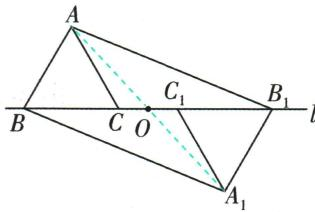
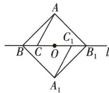
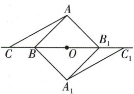
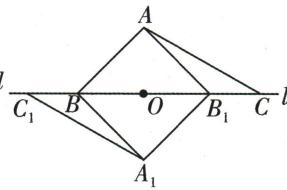

> [!success]- 必刷题
>
> > [!success] **【答案】** 平行四边形
>
> > [!note]- **【解析】**
> > 【解】操作探究1:作图如图(1)所示,则 $OB_{1}=OB,OA_{1}=OA,\therefore$ 四边形 $ABA_{1}B_{1}$ 是平行四边形,故答案为平行四边形.
> > 操作探究2:四边形 $ABA_{1}B_{1}$ 是矩形,理由如下:∵△ABC与△ $A_{1}B_{1}C_{1}$ 关于点O成中心对称,∴ $AB=A_{1}B_{1},\angle ABC=\angle A_{1}B_{1}C_{1},\therefore AB\parallel A_{1}B_{1},\therefore$ 四边形 $ABA_{1}B_{1}$ 是平行四边形.
> >
> > $\because AB = AC, \therefore \angle ABC = \angle ACB. \because \angle ABC + \angle ACB + \angle BAC = 180^{\circ}, \therefore \angle ABC + \frac{1}{2} \angle BAC = 90^{\circ}. \because \angle C_{1}BA_{1} = \frac{1}{2} \angle BAC, \therefore \angle C_{1}BA_{1} + \angle ABC = 90^{\circ}, \therefore \angle ABA_{1} = 90^{\circ}, \therefore$ 四边形 $ABA_{1}B_{1}$ 是矩形.
> >
> > 
> > 图(1)
> >
> > 
> > 图(2)
> >
> > 操作探究 3: 当 $\angle ABC = \angle C_{1}BA_{1} = 45^{\circ}$ 或 $\angle ABC = \frac{1}{3}\angle C_{1}BA_{1} = 45^{\circ}$ 或 $\angle C_{1}BA_{1} = \frac{1}{3}\angle ABC = 45^{\circ}$ 时, 四边形 $ABA_{1}B_{1}$ 是正方形. 如图(2)所示, 当点 $C$ 在线段 $BO$ 上时, $\because$ 四边形 $ABA_{1}B_{1}$ 是正方形, $\therefore \angle ABC = \angle C_{1}BA_{1} = 45^{\circ}$ ; 如图(3)所示, 当点 $B$ 在线段 $CO$ 上时, $\because$ 四边形 $ABA_{1}B_{1}$ 是正方形, $\therefore \angle ABC_{1} = \angle C_{1}BA_{1} = 45^{\circ}, \therefore \angle ABC = 135^{\circ}, \therefore \angle C_{1}BA_{1} = \frac{1}{3}\angle ABC = 45^{\circ}$ ;
> >
> > 
> > 图(3)
> >
> > 
> > 图(4)
> >
> > 如图(4)所示, 当点 O 在线段 BC 上时, ∵ 四边形 $ABA_{1}B_{1}$ 是正方形, ∴ $\angle ABC = \angle CBA_{1} = 45^{\circ}, \therefore \angle C_{1}BA_{1} = 135^{\circ}, \therefore \angle ABC = \frac{1}{3} \angle C_{1}BA_{1} = 45^{\circ}$ . 综上所述, 当 $\angle ABC = \angle C_{1}BA_{1} = 45^{\circ}$ 或 $\angle ABC = \frac{1}{3} \angle C_{1}BA_{1} = 45^{\circ}$ 或 $\angle C_{1}BA_{1} = \frac{1}{3} \angle ABC = 45^{\circ}$ 时, 四边形 $ABA_{1}B_{1}$ 是正方形.
> >
> > ## 23.2.2 中心对称图形
