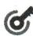

## 23.2.2 中心对称图形

![[初中/课堂同步/教辅/必刷题/2026版《初中必刷题》数学 RJ 9上/23_第二十三章_旋转/23_2_2_中心对称图形/questions/Q00106784.md]]
![[初中/课堂同步/教辅/必刷题/2026版《初中必刷题》数学 RJ 9上/23_第二十三章_旋转/23_2_2_中心对称图形/questions/Q00106785.md]]

## 知识点 2 中心对称图形的性质

![[初中/课堂同步/教辅/必刷题/2026版《初中必刷题》数学 RJ 9上/23_第二十三章_旋转/23_2_2_中心对称图形/questions/Q00106786.md]]
![[初中/课堂同步/教辅/必刷题/2026版《初中必刷题》数学 RJ 9上/23_第二十三章_旋转/23_2_2_中心对称图形/questions/Q00106787.md]]
![[初中/课堂同步/教辅/必刷题/2026版《初中必刷题》数学 RJ 9上/23_第二十三章_旋转/23_2_2_中心对称图形/questions/Q00106788.md]]

## 知识点 3 作中心对称图形

![[初中/课堂同步/教辅/必刷题/2026版《初中必刷题》数学 RJ 9上/23_第二十三章_旋转/23_2_2_中心对称图形/questions/Q00106789.md]]
![[初中/课堂同步/教辅/必刷题/2026版《初中必刷题》数学 RJ 9上/23_第二十三章_旋转/23_2_2_中心对称图形/questions/Q00107259.md]]
