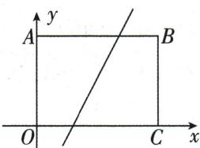
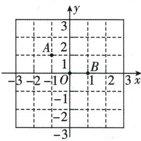

<!-- question-source:start -->
3[2025 河南郑州期末]如图,在平面直角坐标系中,矩形 OABC 的顶点 A 和 C 分别落在 y 轴与 x 轴的正半轴上,OA=6,OC=8. 若直线 $y=2x+b$ 把矩形 OABC 的面积二等分,则 b 的值等于( )
A. 5 B. 2 C. -2 D. -5

(第3题图)

(第4题图)
<!-- question-source:end -->

![[Q00106786A1]]
