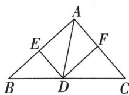
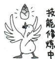

<!-- question-source:start -->
5 如图, $\triangle ABC$ 中, $D$ 是 $BC$ 上一点, $DE \parallel AC$ 交 $AB$ 于 $E, DF \parallel AB$ 交 $AC$ 于 $F$ .

(1) 求证: 四边形 AEDF 是中心对称图形.

(2) 若 AD 平分 $\angle BAC$ ，求证：点 E, F 关于直线 AD 对称.

<!-- question-source:end -->

![[Q00106788A1]]
