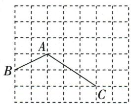

<!-- question-source:start -->
7[2025江西南昌期中]如图,在正方形网格中,点A,B,C是格点,请用无刻度的直尺按要求在网格中作图,并标明字母.

(1)作四边形 ABDC, 使四边形 ABDC 为中心对称图形, 且 D 为格点;

(2) 以 AC 为边作四边形 ACMN, 使四边形 ACMN 既是中心对称图形, 又是轴对称图形, 且 M, N 均为格点.

电子错题本鸭
<!-- question-source:end -->

![[Q00107259A1]]
