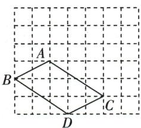
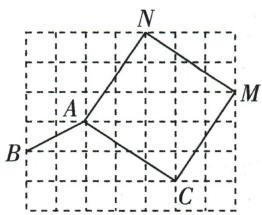

> [!success]- 必刷题
>
> > [!success] **【答案】** 详见解析
>
> > [!note]- **【解析】**
> > 【解】(1)如图(1),四边形ABDC即为所求.
> >
> > (2)如图(2),四边形 ACMN 即为所求(答案不唯一).
> >
> > 
> > 图(1)
> >
> > 
> > 图(2)
> >
> > ## 23.2.3 关于原点对称的点的坐标
