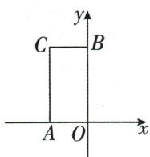
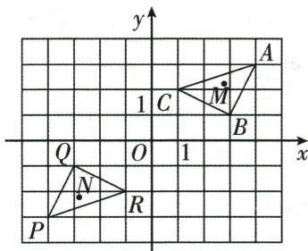

<!-- question-source:start -->
5 如图, 已知矩形 OACB 的两边 OA, OB 分别在 x 轴、y 轴上, 且 A(-1,0), B(0,2). 先将矩形 OACB 沿 x 轴向右平移 2 个单位长度, 得到矩形 $O_{1}A_{1}C_{1}B_{1}$ , 然后作矩形 $O_{1}A_{1}C_{1}B_{1}$ 关于坐标原点 O 的中心对称图形, 得到矩形 $O_{2}A_{2}C_{2}B_{2}$ , 则点 $C_{2}$ 的坐标是 \_\_\_\_.

(第5题图)

(第6题图)
<!-- question-source:end -->

![[Q00106795A1]]
