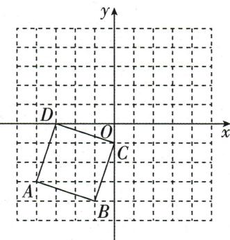

<!-- question-source:start -->
8[2025 天津西青区期中]如图,在平面直角坐标系中,O 为原点,正方形 ABCD 的顶点 A(-4,-3),B(-1,-4),C(0,-1).
(1)顶点 D 的坐标为 \_\_\_\_;
(2)作正方形 ABCD 关于点 O 对称的正方形 A'B'C'D', 点 A, B, C, D 的对应点分别为 A', B', C', D', 在图中画出正方形 A'B'C'D', 并写出其各顶点的坐标.

<!-- question-source:end -->

![[Q00106798A1]]
