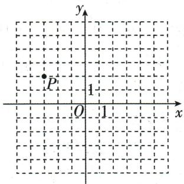
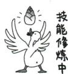

<!-- question-source:start -->
2[中]如图,在平面直角坐标系中,一颗棋子从点P处开始跳动,第一次跳到点P关于x轴的对称点 $P_{1}$ 处,接着跳到点 $P_{1}$ 关于y轴的对称点 $P_{2}$ 处,第三次再跳到点 $P_{2}$ 关于原点的对称点 $P_{3}$ 处, $\cdots$ ,如此循环下去.跳动2023次后,棋子落点处的坐标是\_\_\_\_.

<!-- question-source:end -->

![[Q00106800A1]]
