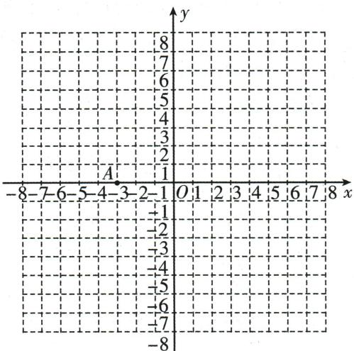

<!-- question-source:start -->
3[2024 上海嘉定区校级期末, 中]如图, 在平面直角坐标系内, 已知点 A 的坐标为 $(-3, 0)$ , 点 B 是第二象限内一点, 且到 x 轴的距离是 5, 到 y 轴的距离是 4.

(1) 在图中描出点 B, 并写出点 B 的坐标: \_\_\_\_.

(2) 点 A 关于 y 轴对称的点 C 的坐标是 \_\_\_\_, 点 B 关于原点对称的点 D 的坐标是 \_\_\_\_.

(3) 将 (2) 中的点 $C, D$ 描在平面直角坐标系中, 并顺次连接各点, 得到的四边形 $ABCD$ 的面积是 \_\_\_\_.
<!-- question-source:end -->

![[Q00106801A1]]
