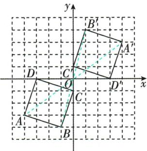

> [!success]- 必刷题
>
> > [!success] **【答案】** (-3,0)
>
> > [!note]- **【解析】**
> > 【解】(1)由题图可得,顶点D的坐标为(-3,0).故答案为(-3,0).
> > (2)如图,正方形 $A^{\prime}B^{\prime}C^{\prime}D^{\prime}$ 即为所求.顶点 $A'(4,3),B'(1,4),C'(0,1),D'(3,0)$ .
> >
> > 
