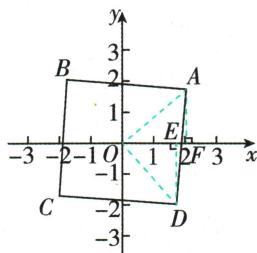

> [!success]- 必刷题
>
> > [!success] **【答案】** B
>
> > [!note]- **【解析】**
> > 根据题意画出正方形 ABCD, 如图, 连接 OA, OD, 过点 A 作 $AF \perp x$ 轴于点 F, 过点 D 作 $DE \perp x$ 轴于点 E, 易证 $\triangle AFO \cong \triangle OED$ (AAS). $\because A(2, \sqrt{3})$ ,
> >
> > 
> >
> > $\therefore OE = AF = \sqrt{3}, DE = OF = 2, \therefore D(\sqrt{3}, -2). \quad \because B, D$ 关于原点对称， $\therefore B(-\sqrt{3}, 2)$ .
> >
> > 故选 **B**.
