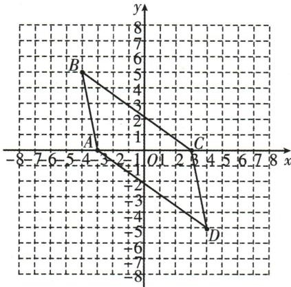

> [!success]- 必刷题
>
> > [!success] **【答案】** (-4,5)
>
> > [!note]- **【解析】**
> > 【解】(1)∵点B是第二象限内一点,且到x轴的距离是5,到y轴的距离是4, $\therefore y_{B}=5,x_{B}=-4,\therefore B(-4,5)$ .点B在平面直角坐标系内的位置如图所示.故答案为(-4,5).
> > (2)∵点A的坐标为(-3,0),∴点A关于y轴对称的点C的坐标是(3,0).∵ $B(-4,5)$ ,∴点B关于原点对称的点D的坐标是(4,-5),故答案为(3,0),(4,-5).
> > (3)四边形ABCD如图所示.
> >
> > 
> >
> > 由图可知, $S_{四边形ABCD}=S_{\triangle ACD}+S_{\triangle ACB}=\frac{1}{2}\times6\times5+\frac{1}{2}\times6\times5=30.$ 故答案为30.
> >
> > ## 刷素养·
