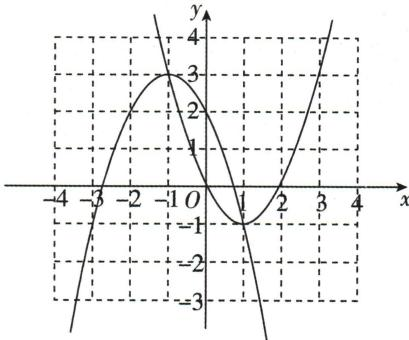
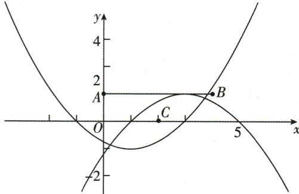
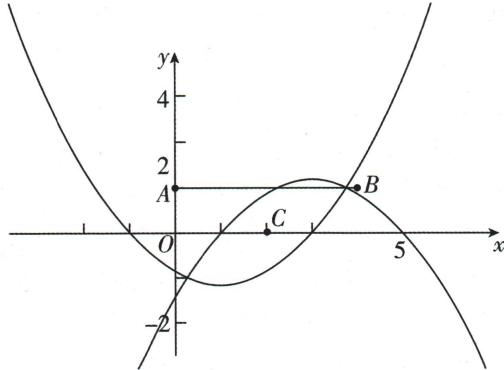
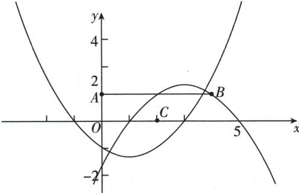

> [!success]- 必刷题
>
> > [!success] **【答案】** $y=-x-1, y=-(x+2)^{2}-1$
>
> > [!note]- **【解析】**
> > 【解】(1)根据题意得互为“对称函数”的两个函数图象上的点分别关于某一点成中心对称.设函数 $y=-x+1$ 图象上的任一点为 $(x,y)$ ，则它关于原点O的对称点为 $(-x,-y)$ .将 $(-x,-y)$ 代入函数 $y=-x+1$ 得 $-y=x+1$ ， $\therefore y=-x-1$ ， $\therefore$ 函数 $y=-x+1$ 关于原点O的“对称函数”的函数解析式为 $y=-x-1$ .同理，设函数 $y=(x-2)^{2}+1$ 图象上的任一点为 $(x,y)$ ，则它关于原点O的对称点为 $(-x,-y)$ .将 $(-x,-y)$ 代入函数 $y=(x-2)^{2}+1$ 得 $y=-(x+2)^{2}-1$ ， $\therefore$ 函数 $y=(x-2)^{2}+1$ 关于原点O的“对称函数”的函数解析式为 $y=-(x+2)^{2}-1$ .故答案为 $y=-x-1, y=-(x+2)^{2}-1$ . (2)函数 $y=x^{2}-2x$ 图象的顶点坐标为(1,-1)，点(1,-1)关于点Q(0,1)的对称点为
> >
> > 思路分析
> > (3) 利用分类讨论的方法分三种情况讨论: ① 当函数 N 的图象的顶点在线段 AB 上时, 求得函数 N 的图象的顶点坐标, 利用对称性求得对称点的坐标, 利用待定系数法即可求解;
> > - **②**：当两个函数图象的交点在线段 AB 上时, 利用函数 N 的图象与 x 轴的交点坐标, 求出函数 N 的解析式, 令 y=1, 即可求得 a 值;
> > - **③**：当函数 N 的图象经过点 B 时, 将点 B 的坐标代入函数 N 的解析式, 并结合图象即可确定 a 的取值范围.
> >
> > (-1,3). $\because$ 函数 $y = x^{2} - 2x$ 与函数 $G$ 关于点 $Q(0,1)$ 互为“对称函数”， $\therefore$ 函数 $G$ 的解析式为 $y = -(x + 1)^{2} + 3$ . 如图(1)，函数 $y = x^{2} - 2x$ 与函数 $G$ 的图象如图所示.
> >
> > 
> > 图(1)
> >
> > $\because$ 函数 $G$ 的图象开口向下, $\therefore$ 在对称轴的右侧 $y$ 随自变量 $x$ 的增大而减小. $\because$ 函数 $y = x^{2} - 2x$ 的图象开口向上, $\therefore$ 在对称轴的左侧 $y$ 随自变量 $x$ 的增大而减小, $\therefore$ 函数 $y = x^{2} - 2x$ 与函数 $G$ 的函数值 $y$ 都随自变量 $x$ 的增大而减小时, 自变量 $x$ 的取值范围为 $-1 < x < 1$ . (3) 对于 $y = ax^{2} - 2ax - 3a$ , 令 $y = 0$ , 则 $ax^{2} - 2ax - 3a = 0$ , 解得 $x_{1} = -1, x_{2} = 3$ , $\therefore$ 二次函数 $y = ax^{2} - 2ax - 3a (a > 0)$ 的图象与 $x$ 轴的交点为 $(-1, 0)$ 和 $(3, 0)$ . ① 当函数 $N$ 的图象的顶点在线段 $AB$ 上时, 如图(2).
> >
> > 
> > 图(2)
> >
> > $\because y = ax^{2} - 2ax - 3a = a(x - 1)^{2} - 4a, \therefore$ 二次函数 $y = ax^{2} - 2ax - 3a$ 的图象的对称轴为直线 $x = 1$ . $\because$ 点 $C(2,0)$ 为对称中心， $\therefore$ 函数 $N$ 的图象的对称轴为直线 $x = 3, \therefore$ 函数 $N$ 的图象的顶点坐标为 $(3,1)$ . $\because$ 点 $(3,1)$ 关于点 $C(2,0)$ 对称的点为 $(1, -1), \therefore$ 将 $(1, -1)$ 代入 $y = ax^{2} - 2ax - 3a$ 得 $a - 2a - 3a = -1, \therefore a = \frac{1}{4}$ .
> > - **②**：当两个函数图象的交点在线段 $AB$ 上时，如图(3). $\because$ 二次函数 $y = ax^{2} - 2ax - 3a$ 的图象与 $x$ 轴的交点为 $(-1,0)$ 和 $(3,0)$ ，点 $C(2,0)$ 为对称中心， $\therefore$ 函数 $N$ 的图象与 $x$ 轴的交点为 $(5,0)$ 和 $(1,0), \therefore$ 函数 $N$ 的解析式为 $y = -ax^{2} + 6ax - 5a$ .
> >
> > 当 $y = 1$ 时， $\left\{ \begin{array}{l}ax^2 -2ax - 3a = 1,\\ -ax^2 +6ax - 5a = 1, \end{array} \right.\therefore a = \frac{\sqrt{3}}{6}.$
> >
> > 
> > 图(3)
> > - **③**：当函数 N 的图象经过点 B 时, 如图(4).
> >
> > 
> > 图(4)
> >
> > 将 $B(4,1)$ 代入 $y = -ax^2 + 6ax - 5a$ ，得 $1 = -a \times 16 + 6a \times 4 - 5a$ ，解得 $a = \frac{1}{3}$ . 综上，图形 $W$ 与线段 $AB$ 恰有 2 个公共点时， $a$ 的取值范围为 $a = \frac{1}{4}$ 或 $a = \frac{\sqrt{3}}{6}$ 或 $a > \frac{1}{3}$ .
> >
> > 思路分析
> > 根据中心对称图形的定义一一判断即可.
> >
> > ## 23.3 课题学习 图案设计
