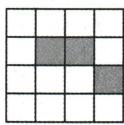

<!-- question-source:start -->
4 如图是 $4 \times 4$ 的正方形网格, 其中已有 3 个小方格涂成了灰色. 现在要从其余 13 个白色小方格中选出一

个也涂成灰色,与原来3个灰色小方格组成的图形成为轴对称图形,则符合要求的白色小方格有
( )
A. 1 个 B. 2 个 C. 3 个 D. 4 个
<!-- question-source:end -->

![[Q00106806A1]]
