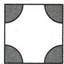
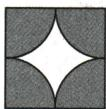
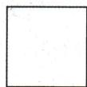
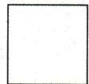
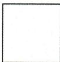

<!-- question-source:start -->
5[2025 新疆乌鲁木齐期中]为创建绿色校园,学校决定在一块正方形的空地上种植花草,现向学生征集设计图案.图案要求只能用圆弧在正方形内加以设计,使正方形和所画的圆弧构成图案,种植花草部分用阴影表示.请你运用平移、旋转、轴对称等知识,在图③、图④、图⑤中画出三种不同的设计图案(温馨提示:在两个图案中,只有半径变化而圆心不变的图案属于同一种,例如:图①、图②只能算一种).

①

②

③

④

⑤
<!-- question-source:end -->

![[Q00106807A1]]
