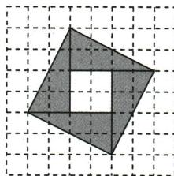
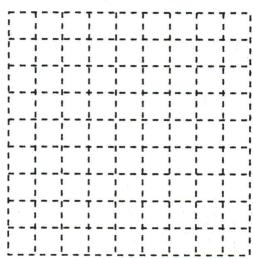
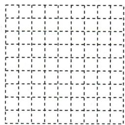
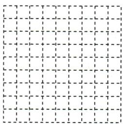
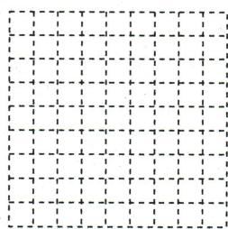

<!-- question-source:start -->
6[2025 四川广安调研]如图是在北京举办的国际数学家大会的会标“弦图”的大致形状. 请将图案中的四个直角三角形通过你所学过的图形变换, 在以下方格纸中按要求设计另外四个不

同的图案. 作图要求: ①每个直角三角形的顶点均在方格纸的格点上, 且四个三角形互不重叠; ②所设计的图案 (不含方格纸) 经过变换后与其他图案相同的视为一种设计

只是中心对称图形

只是轴对称图形

既是轴对称图形也是中心对称图形

既不是轴对称图形
也不是中心对称图形

是个新“烤”鸭
电子错题本鸭

建议用时 40 分钟
<!-- question-source:end -->

![[Q00107261A1]]
