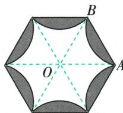
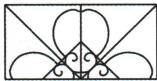

> [!success]- 必刷题
>
> > [!success] **【答案】** $60^{\circ}$
>
> > [!note]- **【解析】**
> > 如图. ∵ 图案的外轮廓为正六边形, ∴ $\angle AOB = 360^{\circ} \div 6 = 60^{\circ}$ , ∴ 旋转角度 $\alpha$ 的最小值为 $60^{\circ}$ . 故答案为 $60^{\circ}$ .
> >
> > 
> >
> > 思路分析
> > 由点 A, B 关于原点对称，可求出 m 的值，进而可得出点 A 的坐标，再利用待定系数法即可求出正比例函数的解析式.
> >
> > 
