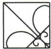

> [!success]- 必刷题
>
> > [!success] **【答案】** 详见解析
>
> > [!note]- **【解析】**
> > 【解】方法一:以为基本图形,以图案正中间的水平线段所在直线为对称轴,进行一次轴对称变换.
> > 方法二:以为基本图形,以图案中心为旋转中心,把基本图形按顺时针方向分别旋转90°,180°,270°即可得到.(答案不唯一)
> >
> > 
