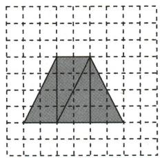
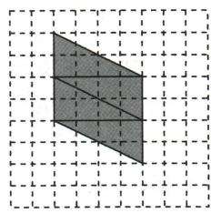
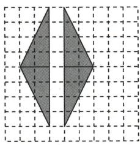
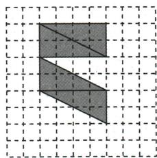

> [!success]- 必刷题
>
> > [!success] **【答案】** 详见解析
>
> > [!note]- **【解析】**
> > 【解】所画图形如图所示.(答案均不唯一)
> >
> > 
> > 只是轴对称图形
> >
> > 
> > 只是中心对称图形
> >
> > 
> > 既是轴对称图形
> > 也是中心对称图形
> >
> > 
> > 既不是轴对称图形
> > 也不是中心对称图形
> >
> > ## 全章综合训练
