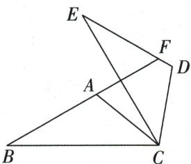

<!-- question-source:start -->
3[2024 天津中考]如图, $\triangle ABC$ 中, $\angle B = 30^{\circ}$ , 将 $\triangle ABC$ 绕点 $C$ 顺时针旋转 $60^{\circ}$ 得到 $\triangle DEC$ , 点 $A, B$ 的对应点分别为 $D, E$ , 延长 $BA$ 交 $DE$ 于点 $F$ , 下列结论一定正确的是 ( )

A. $\angle ACB = \angle ACD$ B. $AC / / DE$ C. $AB = EF$ D. $BF\perp CE$
<!-- question-source:end -->

![[Q00106811A1]]
