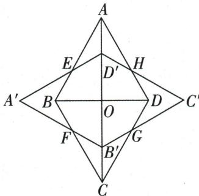
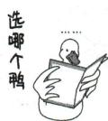

<!-- question-source:start -->
4[2024 北京中考] 如图, 在菱形 $ABCD$ 中, $\angle BAD = 60^{\circ}, O$ 为对角线的交点. 将菱形 $ABCD$ 绕点 $O$ 逆时针旋转 $90^{\circ}$ 得到菱形 $A'B'C'D'$ , 两个菱形的公共点为 $E, F, G, H$ . 对八边形 $BFB'GDHD'E$ 给出下面四个结论: ①该八边形各边长都相等; ②该八边形各内角都相等; ③点 $O$ 到该八边形各顶点的距离都相等; ④点 $O$ 到该八边形各边所在直线的距离都

相等.

上述结论中,所有正确结论的序号是（）

A. ①③
B. ①④
C. ②③
D. ②④
<!-- question-source:end -->

![[Q00106812A1]]
