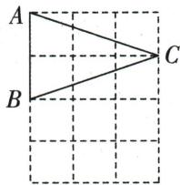
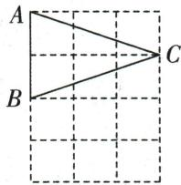

<!-- question-source:start -->
5[2024 湖北武汉中考]如图是由小正方形组成的 $3 \times 4$ 网格, 每个小正方形的顶点叫做格点. $\triangle ABC$ 三个顶点都是格点. 仅用无刻度的直尺在给定网格中完成四个画图任务, 每个任务的画线不得超过三条. (1) 在图(1)中, 画射线 $AD$ 交 $BC$ 于点 $D$ , 使 $AD$ 平分 $\triangle ABC$ 的面积; (2) 在(1)的基础上, 在射线 $AD$ 上画点 $E$ , 使 $\angle ECB = \angle ACB$ ; (3) 在图(2)中, 先画点 $F$ , 使点 $A$ 绕点 $F$ 顺时针旋转 $90^{\circ}$ 到点 $C$ , 再画射线 $AF$ 交 $BC$ 于点 $G$ ; (4) 在(3)的基础上, 将线段 $AB$ 绕点 $G$ 旋转 $180^{\circ}$ , 画对应线段 $MN$ (点 $A$ 与点 $M$ 对应, 点 $B$ 与点 $N$ 对应).

图(1)

图(2)
<!-- question-source:end -->

![[Q00106813A1]]
