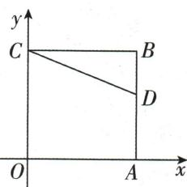
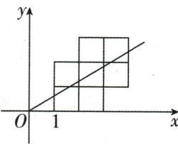

<!-- question-source:start -->
5[2024 河北石家庄期中]如图,正方形 OABC 的两边 OA, OC 分别在 x 轴、y 轴上,点 D(5,3) 在边 AB 上,以 C 为中心,把 $\triangle CDB$ 旋转 $90^{\circ}$ ,则旋转后点 D 的对应点 $D'$ 的坐标是 ( )
A. (2,10) B. (-2,0)
C. (2,10) 或 (-2,0) D. (10,2) 或 (-2,0)

(第 5 题图)

(第6题图)
<!-- question-source:end -->

![[Q00106818A1]]
