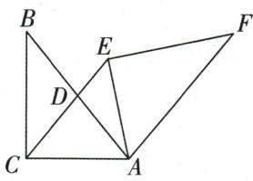
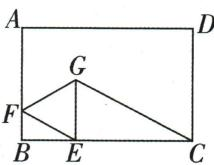

<!-- question-source:start -->
7 如图, Rt△ABC 中, ∠ACB = 90°, D 是斜边 AB 的中点, 将 △ABC 绕点 A 按顺时针方向旋转, 点 C 落在 CD 的延长线上的 E 处, 点 B 落在 F 处, 若 AC = 4√2, BC = 2√17, 则 CE 的长为
( )
A. 7.5    B. 6
C. 6.4    D. 6.5

(第7题图)

(第8题图)
<!-- question-source:end -->

![[Q00106820A1]]
