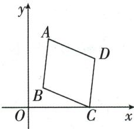
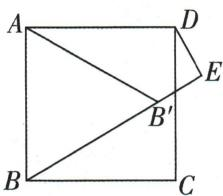

<!-- question-source:start -->
9 如图, 已知平面直角坐标系中的 □ABCD, 点 A(1,4), C(3,0), 坐标系内存在直线 $l: y = kx + b (k \neq 0)$ 将

□ABCD 分成面积相等的两部分,且这条直线与两坐标轴围成的三角形的面积为1，则k的值为
A.4或 $\frac{1}{4}$ B. $\frac{1}{3}$ 或3
C.2或 $\frac{1}{2}$ D.4或 $\frac{1}{2}$

(第9题图)

(第 10 题图)
<!-- question-source:end -->

![[Q00106822A1]]
