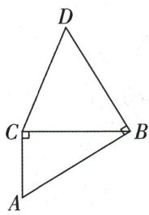
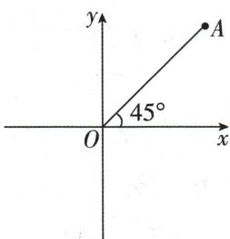

<!-- question-source:start -->
11 如图, 已知在 Rt△ABC 中, ∠ACB = 90°, AC = 3, BC = 4, 现将 AB 绕点 B 顺时针旋转 90° 得到 BD, 连接 CD, 则 △BCD 的面积为 \_\_\_\_.

(第 11 题图)

(第 12 题图)
<!-- question-source:end -->

![[Q00106824A1]]
