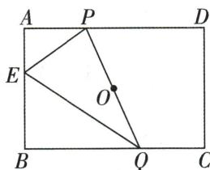

<!-- question-source:start -->
13[2025 广东中山期末]如图, 点 O 是矩形 ABCD 的对称中心, 点 P, Q 分别在边 AD, BC 上, 且 PQ 经过点 O, AB = 6, AP = 3, BC = 8, 点

E 是边 AB 上一动点, 则 $\triangle EPQ$ 周长的最小值为 \_\_\_\_.

<!-- question-source:end -->

![[Q00106826A1]]
