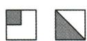
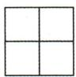
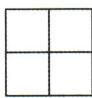
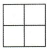
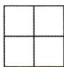

<!-- question-source:start -->
14[2025 辽宁鞍山质检]实践与操作:现有如图(1)所示的两种小正方形瓷砖(图(1)中阴影正方形的边长是小正方形边长的一半),请从这两种瓷砖中各选2块,按下列要求拼铺成一个新的图案.
(1) 在图(2)、图(3) 中各设计一种拼法,使图(2) 是轴对称图形而不是中心对称图形,图(3) 是中心对称图形而不是轴对称图形;
(2) 在图(4)、图(5) 中各设计一种拼法,使这两个图案都既是轴对称图形又是中心对称图形,且互不相同。(两个图案之间若能通过轴对称、平移、旋转变换相互得到,则视为同一种图案)

图(1)

图(2)

图(3)

图(4)

图(5)
<!-- question-source:end -->

![[Q00106827A1]]
