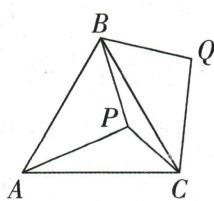

<!-- question-source:start -->
15[2024江西南昌校级期末]如图， $P$ 是等边 $\triangle ABC$ 内的一点，且 $PA = 5, PB = 4, PC = 3$ ，将 $\triangle APB$ 绕点 $B$ 逆时针旋转，得到 $\triangle CQB.$ (1)旋转角为\_\_\_\_度；(2)求点 $P$ 与点 $Q$ 之间的距离；(3)求 $\angle BPC$ 的度数.

<!-- question-source:end -->

![[Q00106828A1]]
