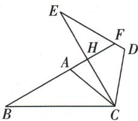

> [!success]- 必刷题
>
> > [!success] **【答案】** D
>
> > [!note]- **【解析】**
> > 记 BF 与 CE 相交于点 H, 如图所示. ∵ 将 $\triangle ABC$ 绕点 C 顺时针旋转 $60^{\circ}$ 得到 $\triangle DEC$ , ∴ $\angle BCE = \angle ACD = 60^{\circ}$ .
> >
> > 
> >
> > $\because \angle B = 30^{\circ}, \therefore$ 在 $\triangle BHC$ 中, $\angle BHC = 180^{\circ} - \angle BCE - \angle B = 90^{\circ}, \therefore BF \perp CE$ , 故 D 选项正确, 符合题意. 设 $\angle ACH = x^{\circ}, \therefore \angle ACB = 60^{\circ} - x^{\circ}$ . $\because \angle B = 30^{\circ}, \therefore \angle EDC = \angle BAC = 180^{\circ} - 30^{\circ} - (60^{\circ} - x^{\circ}) = 90^{\circ} + x^{\circ}, \therefore \angle EDC + \angle ACD = 90^{\circ} + x^{\circ} + 60^{\circ} = 150^{\circ} + x^{\circ}$ . $\because x^{\circ}$ 不一定等于 $30^{\circ}$ , $\therefore \angle EDC + \angle ACD$ 不一定等于 $180^{\circ}, \therefore AC // DE$ 不一定成立, 故 B 选项不正确, 不符合题意. $\because \angle ACB = 60^{\circ} - x^{\circ}, \angle ACD = 60^{\circ}, x^{\circ}$ 不一定等于 $0^{\circ}, \therefore \angle ACB = \angle ACD$ 不一定成立, 故 A 选项不正确, 不符合题意. $\because$ 将 $\triangle ABC$ 绕点 C 顺时针旋转 $60^{\circ}$ 得到 $\triangle DEC, \therefore AB = ED = EF+$
> >
> > $FD, \therefore BA \geqslant EF,$ 故 C 选项不正确, 不符合题意.
> >
> > 故选 **D**.
