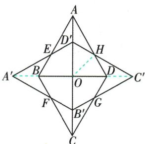
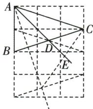

> [!success]- 必刷题
>
> > [!success] **【答案】** B
>
> > [!note]- **【解析】**
> > 如图，连接 $A'B, C'D, OH.$ ∵ 四边形 ABCD 是菱形， $\angle BAD = 60^{\circ}$ ，
> > ∴ $\angle ABD = \angle CBD = \angle CDB = \angle ADB = 60^{\circ}$ ，∠BAO =
> >
> > 
> >
> > $\angle DAO = \angle BCO = \angle DCO = 30^{\circ}, \angle BOC = \angle DOC = \angle AOD = \angle AOB = 90^{\circ}.$ ∵菱形ABCD绕点O逆时针旋转 $90^{\circ}$ 得到菱形 $A'B'C'D'$ ，∴ $A', C'$ 在BD所在直线上， $B', D'$ 在AC所在直线上， $OD = OD' = OB = OB', OA = OA' = OC = OC', \angle FA'B = \angle EA'B = \angle EAD' = \angle HAD' = \angle HC'D = \angle GC'D = \angle GCB' = \angle FCB' = 30^{\circ},$ ∴ $AD' = C'D = B'C = A'B.$ ∵ $\angle D'HA = \angle DHC'$ ∴ $\triangle AD'H \cong \triangle C'DH, \therefore D'H = DH$ ，同理可证 $D'E=BE, BF=B'F, B'G=DG.$ ∵ $\angle EA'B = \angle HC'D = 30^{\circ}, A'B = C'D, \angle A'BE = \angle C'DH = 120^{\circ},$ ∴ $\triangle A'BE \cong \triangle C'DH, \therefore DH=BE,$ 同理可证 DG=BF, ∴ $DH=BE=D'H=D'E=BF=FB'=B'G=DG,$ ∴ 该八边形各边长都相等，故①正确. 由题易得 $\angle ED'H = 120^{\circ}, \angle D'OD = 90^{\circ}, \angle OD'H = \angle ODH = 60^{\circ},$ ∴ $\angle D'HD = 150^{\circ},$ ∴ 该八边形各内角不相等，故②错误.
> > ∵ $OD' = OD, D'H = DH, OH = OH, \therefore \triangle D'OH \cong \triangle DOH, \therefore \angle D'HO = \angle DHO = 75^{\circ}, \therefore \angle OHD \neq \angle ODH, \therefore OD \neq OH, \therefore$ 点 O 到该八边形各顶点的距离不都相等，故③错误. 根据角平分线的性质定理易得点 O 到该八边形各边所在直线的距离都相等，故④正确. 故选 B.
> >
> > 易错警示
> > 当问题中旋转方向或旋转角度不明确时，要注意分类讨论.
> >
> > 思路分析
> > 令中间三个正方形组成的四边形为矩形ABCD，连接AC,BD,相交于点M,则直线y=kx经过点M,由图易得点M的坐标,代入y=kx可得k的值.
> >
> > 
