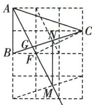

> [!success]- 必刷题
>
> > [!success] **【答案】** 详见解析
>
> > [!note]- **【解析】**
> > 【解】(1)如图(1),射线AD即为所求.
> > (2)如图(1),点E即为所求.
> >
> > 图(1)
> > 
> > 图(2)
> >
> > (3)如图(2)，点F、射线AF、点G即为所求.
> > (4)如图(2), 线段 MN 即为所求.
