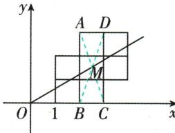

> [!success]- 必刷题
>
> > [!success] **【答案】** D
>
> > [!note]- **【解析】**
> > 如图, 令中间三个正方形组成的
> >
> > 四边形为矩形 ABCD，连接 AC, BD，相交于点 M，∴ 易得点 M 的坐标为 $\left(\frac{5}{2}, \frac{3}{2}\right)$ . ∵ 直线
> >
> > 
> >
> > $y = kx$ 将这七个正方形分成面积相等的两部分，∴ 直线 $y = kx$ 经过点 $M\left(\frac{5}{2}, \frac{3}{2}\right)$ . 将 $M\left(\frac{5}{2}, \frac{3}{2}\right)$ 代入 $y = kx$ ，得 $\frac{5}{2}k = \frac{3}{2}$ ，解得 $k = \frac{3}{5}$ .
> >
> > 故选 **D**.
