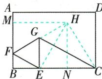

> [!success]- 必刷题
>
> > [!success] **【答案】** B
>
> > [!note]- **【解析】**
> > 如图, 以 EC 为边作等边三角形 ECH, 过点 H 作 $HN \perp BC$ 于 N, $HM \perp AB$ 于 M, 连接 FH.
> >
> > 
> >
> > $\because \angle ABC = 90^{\circ}, \therefore$ 四边形 MHNB 是矩形， $\therefore MH = BN, \because BE = 1, \therefore EC = 2, \because \triangle EHC$ 是等边三角形， $HN \perp EC, \therefore EC = EH = 2, EN = NC = 1, \angle HEC = 60^{\circ}, \therefore BN = 2 = MH, \because \triangle FGE$ 是等边三角形， $\therefore FE = GE, \angle FEG = 60^{\circ} = \angle HEC, \therefore \angle FEH = \angle GEC.$ 在 $\triangle FEH$ 和 $\triangle GEC$ 中， $\left\{ \begin{array}{l} FE = GE, \\ \angle FEH = \angle GEC, \therefore \triangle FEH \cong \triangle GEC(\text { SAS }) , \\ HE = EC, \end{array} \right.$ $\therefore FH = GC, \therefore$ 当 $FH \perp AB$ 时， $FH$ 有最小值，即 $GC$ 有最小值. $\because$ 点 $F$ 与点 $M$ 重合时， $FH = HM = 2, \therefore GC$ 的最小值为 2.
> >
> > 故选 **B**.
