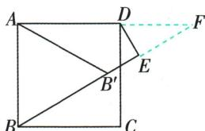

> [!success]- 必刷题
>
> > [!success] **【答案】** A
>
> > [!note]- **【解析】**
> > 如图, 分别延长 AD 和 BE 交于点 F. ∵ AB = AB', ∠BAB' = 60°, ∴ △ABB'
> >
> > 
> >
> > 为等边三角形， $\therefore \angle ABB' = 60^\circ$ 。 $\because AB = 2$ ， $\angle BAF = 90^\circ$ ， $\angle ABF = 60^\circ$ ， $\therefore \angle F = 90^\circ - \angle ABF = 30^\circ$ ， $\therefore BF = 2 \times 2 = 4$ ， $AF = \sqrt{BF^2 - AB^2} = 2\sqrt{3}$ ， $\therefore DF = AF - AD = 2\sqrt{3} - 2$ 。 $\because \angle DEF = 90^\circ$ ， $\therefore DE = \frac{1}{2}DF = \sqrt{3} - 1$ ， $\therefore EF = 3 - \sqrt{3}$ 。 $\because \triangle ABB'$ 是等边三角形， $\therefore BB' = AB = 2$ ， $\therefore B'E = BF - BB' - EF = 4 - 2 - (3 - \sqrt{3}) = \sqrt{3} - 1$ ，
> >
> > 故选 **A**.
